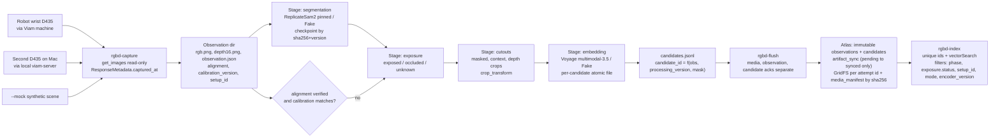

# RGB-D brick collection pipeline (SKY-66 slice 1, revised)

## What we are building and the goal

Build a local-first collection pipeline that turns a saved RGB-D camera snapshot into individual brick records: image cutouts, evidence-based exposure labels, and searchable embeddings. Every record links back to its source observation, calibration, and processing settings; pickability remains unknown.

This slice is complete when the synthetic scene runs end to end offline, its brick records can be inspected in a gallery, and interrupted processing resumes without losing completed work or duplicating records. After the separately authorized integration checks, capture one real read-only observation and verify that its records and media can be uploaded to Atlas, read back, and uploaded again without duplication. The result is a reusable brick dataset for later perception and grasp-planning work; physical stacking remains a later milestone.

Linear: [SKY-66](https://linear.app/skymoondev/issue/SKY-66/implement-rgb-d-records-candidate-embeddings-and-atlas-indexes). Branch: `filesmuggler/sky-66-implement-rgb-d-records-candidate-embeddings-and-atlas` off `main`. Scope: observations + candidates. Out: attempts collection, trajectories, grasp eligibility, motion.

Note: the SKY-75 files that were untracked at session start (`rgbd.py`, `png_io.py`, `tests/test_rgbd.py`, `fixtures/rgbd/mock-capture.json`) are gone from disk; only an empty `fixtures/rgbd/` remains. Restore them before I start if you still have them; otherwise I re-create the observation schema.

## Revision summary (review findings)

- Alignment is a gate, not a flag: exposure classification runs only when `alignment.status == verified` and the observation's `calibration_version` matches the registered calibration for that `setup_id`; otherwise exposure is `unknown` with a reason.
- `pickable` is removed. Candidates carry `exposure` (from geometry) and `pickability.status = "unknown"` (grasp eligibility is SKY-87). Footprint reasoning is disabled unless block dimensions are marked verified and the view is a registered top-down pose.
- Processing identity hashes the complete effective configuration (provider params, exposure thresholds, block dimensions and verified flag, calibration file contents including viewing pose, cutout settings, embedding text/preprocessing settings); checkpoints are validated by content and input hashes before a stage is skipped; `candidate_id`s are deterministic; insert-only remote writes never conflict.
- Remote state is split: immutable `observations`/`candidates`; a mutable `artifact_sync` collection whose `remote_status` only moves `pending -> synced` (local availability is tracked separately and never downgrades remote state); and media under an ownership protocol: each upload is a unique attempt id owning its GridFS file, a SHA-keyed insert-only `media_manifest` decides the winner, losers delete only their own file, and orphan cleanup is age-bounded by attempt state so it can never remove an in-progress upload.
- Segmentation cache keys derive from the image hash plus the provider's canonical effective settings (the same object the processing identity hashes), not from a version label.
- Depth crops and depth statistics reuse RGB crop coordinates only under verified registration; otherwise they are omitted with a reason.
- Provider contracts are captured first (pinned Replicate version, documented request/poll/output shape, saved response fixtures) and adapters are tested against those fixtures before any pipeline code depends on them.
- RGB-D tests cannot all skip: a second CI job installs the `rgbd` extra and runs with `RGBD_TESTS_REQUIRED=1`.
- New capture source: a second D435 on this Mac through a local `viam-server` + `viam:camera:realsense` module. Same Viam code path; different `setup_id` and `calibration_version`.

## Flow

## Step 0: provider contract capture (before pipeline code depends on it)

`docs/PROVIDERS.md` documents, and `fixtures/providers/` stores, the sanitized shapes the adapters parse.

- Replicate SAM 2: unauthenticated `GET /v1/models/meta/sam-2` returns no `latest_version`, so the operator runs the authenticated GET once, records the version hash as `REPLICATE_SAM2_VERSION`, and saves the `openapi_schema.components.schemas.Input/Output` subset. Planned contract to confirm against that schema: `POST /v1/predictions` with `{version, input: {image: data URI, points_per_side, pred_iou_thresh, stability_score_thresh, use_m2m}}`, header `Prefer: wait=60`; if `status` is `starting|processing`, poll `GET /v1/predictions/{id}` with bounded attempts; terminal states `succeeded|failed|canceled`; expected output `combined_mask` + `individual_masks` URLs, each downloaded and decoded to a binary mask with dimensions checked against the source image. One prediction on the synthetic mock scene (not a private capture) is saved as `fixtures/providers/replicate-sam2/prediction.json` with token and URLs redacted and the mask PNGs stored alongside.
- Voyage: endpoint `https://ai.mongodb.com/v1/multimodalembeddings`, model `voyage-multimodal-3.5`, default 1024 dims, `input_type: document`, inputs `[{"content": [{"type":"text",...},{"type":"image_base64",...}]}]`. One call on a synthetic crop saved as `fixtures/providers/voyage/response.json`. Documentation supports the shape; credentials and connectivity are verified only by this run.
- Both runs need your go-ahead for sending the synthetic image to those destinations and your keys at hidden prompts; nothing is sent by default. Adapters ship with parsers tested against the fixtures; until the operator run happens, `docs/INTEGRATIONS.md` lists both as unverified.

## Modules (new, `src/robot_hackathon/`)

- `rgbd.py`: Observation schema v1. Fields: `observation_id`, `episode_id` (collection session), `mode`, `setup_id` (`robot-wrist-d435` | `mac-desk-d435` | `mock`), `camera {resource_name, serial_or_null, model}`, `captured_at` (from `ResponseMetadata.captured_at`, UTC), `timing {clock_source: "viam_response_metadata", per_image_timestamps: "not_provided", rgb_depth_skew_ms: null, uncertainty_note}`, `intrinsics {rgb, depth}` from `get_properties` (null when absent), `depth {unit: mm, scale_m_per_unit: 0.001, invalid_value: 0, dtype: uint16}`, `alignment {status: verified|unverified|unknown, method, calibration_version, checked_at, checked_by}`, `calibration_version`, artifacts `[{kind: rgb|depth, path, sha256, media_type, width, height}]`, `flags[]`. Loader validates hashes; dimension equality is recorded as a fact, not as alignment. Calibration registry: `data/<mode>/calibration/<setup_id>/<calibration_version>.json` written by `rgbd-calibration record` with the operator's alignment verdict and method; observations captured under that setup reference it.
- `capture.py`: `capture_observation(config)` using `Camera.get_images()` read-only on resource `cam` (name configurable per setup). Decodes RGB via Pillow and depth `image/vnd.viam.dep` (magic, BE uint64 width/height, BE uint16). Works for any `MACHINE_ADDRESS`; for the Mac camera the address is the local viam-server. Mock path writes a synthetic scene with two overlapping and one clear rectangle at distinct depths and a registered mock calibration with `alignment.status = verified` so the full pipeline is exercisable offline. `rgbd-overlay <obs>` renders depth edges over RGB to a PNG/HTML for the operator's alignment check; the verdict is recorded by `rgbd-calibration`, not inferred.
- `segmentation.py`: `SegmentationProvider.segment(observation) -> SegmentationResult` (masks in source pixel coordinates as 1-bit PNG bytes, bbox, area, score, `provider`, `model_version`, `params_version`, `request_params`, `latency_ms`). `FakeSegmentationProvider` (color threshold on mock scene) and `ReplicateSam2Provider` (pinned version from config, urllib, bounded wait + poll, no automatic retries, parser validated by fixture). Each provider exposes `effective_settings()` (provider id, pinned model version, every request parameter it sends, parser version); `params_version` is only a human-readable label and never part of any key. Stage checkpoint `segmentation/<seg_key>.json` where `seg_key = sha256(canonical JSON of {image_sha256, effective_settings()})`, and the checkpoint stores that JSON so a hit is validated by content, not by filename; a validated hit never calls the provider, and changing any threshold changes the key. The same `effective_settings()` is what the processing identity consumes, so the two can't disagree.
- `exposure.py`: versioned `ExposureParams` v1. Gate: `alignment.status == verified` and `observation.calibration_version == registry[setup_id].current` and depth intrinsics present; otherwise every mask gets `exposure.status = unknown` with `reasons: ["alignment_not_verified" | "calibration_mismatch" | "intrinsics_missing"]`. When gated in: robust depth per mask, invalid-depth fraction, boundary contact with a neighbor mask that is closer to the camera (overlap evidence). Footprint/aspect reasoning only when `block_dimensions.verified == true` and the setup registers a top-down viewing pose; default off. Output `exposure {status, score, reasons[], params_version, label_source: "heuristic"}` and `pickability {status: "unknown", reason: "grasp eligibility not evaluated (SKY-87)"}`. Empty candidate sets are valid.
- `cutouts.py`: masked RGB cutout and context crop with margin keeping neighbors, `crop_transform {x0, y0, width, height, scale: 1}` in RGB pixel coordinates; `cutout_version = "ctx-v1"`. The uint16 depth crop reuses the RGB crop rectangle only when the observation's registration is verified (`alignment.status == verified` and calibration matches); otherwise `depth_crop = null` with `depth_crop_reason = "registration_not_verified"`. A separate depth-frame mapping is not implemented in this slice, so there is no depth crop without verified registration. The same gate decides whether depth statistics enter the embedding text.
- `embeddings.py`: `EmbeddingProvider.embed(candidate) -> vector`. `FakeEmbeddingProvider` (deterministic 1024-d) and `VoyageMultimodalProvider` (text geometry summary from a versioned template + context crop, `input_type: document`). The provider exposes an `effective_settings()` dict (model, output dimension, input_type, text template id and template content sha256, image preprocessing: resize bound, format, quality) that feeds the processing identity. `encoder_version` remains a human-readable label (`"voyage-multimodal-3.5/ctx-v1"`, `"fake/ctx-v1"`) stored next to the hash. Each candidate's vector is written atomically to its own file before the candidate record is finalized.
- `pipeline.py`: orchestrator. Processing identity: `effective_config.json` is the canonical (sorted-keys) JSON of everything that affects results: `pipeline_code_version`, segmentation provider + pinned model version + full request params, exposure params (all thresholds, `block_dimensions_mm`, `block_dimensions_verified`, footprint reasoning enabled flag), the registered calibration file contents (sha256 of the calibration JSON, which carries alignment verdict and viewing pose), cutout settings (margin, versions), and the embedding provider's `effective_settings()`. `processing_version = sha256(effective_config.json)[:16]`; the file itself is stored in the processing directory for audit. `candidate_id = "cand_" + sha256(observation_id + processing_version + mask_index)[:20]`. Stages write under `data/<mode>/observations/<obs_id>/processing/<processing_version>/<stage>.json`; each checkpoint carries `{stage, processing_version, input_sha256s, outputs: [{path, sha256}], checkpoint_sha256}`. A stage is skipped only if its checkpoint parses, its `processing_version` and recorded input hashes match the current inputs (source RGB/depth shas, upstream checkpoint sha), every listed output file exists with a matching sha256, and the checkpoint's own hash verifies; anything else moves the directory entry to `stale/` and recomputes. A failed embedding call leaves verified segmentation, exposure and cutout checkpoints intact. Changing any provider, parameter or calibration content yields a new `processing_version`, new candidate IDs and a separate directory; old candidates remain untouched. `rgbd-status` prints per observation: stage validity, per-artifact `local_status` and `remote_status`, and candidate acks.
- `candidate_store.py`: `CandidateLocalStore` reusing `atomic_write` and locking from `local_store.py`; `candidates.jsonl` keyed by `candidate_id` (identical re-put tolerated, different content rejected). Candidate document: ids, `mode`, `setup_id`, `phase: "pick"`, bbox, `mask_sha256`, `crop_transform`, depth stats (mm, invalid fraction), `exposure`, `pickability`, `segmentation {provider, model_version, params_version}`, `cutout_version`, `encoder_version`, `embedding`, `cutout_sha256`, `processing_version`, `calibration_version`, `created_at`. Cutout, context crop and mask PNG bytes live as files locally and are attached as BSON `Binary` at upload.
- `mongo_store.py` extension (`RgbdMongoStore`): three kinds of remote state with different mutability.
  - Immutable: `observations` (metadata + artifact list with `kind`, `sha256`, `media_type`, `bytes`; no upload status) and `candidates` (inline `cutout_png`, `context_png`, `mask_png` Binary + embedding). Insert-only upsert with read-back, like `MongoStore.upsert`.
  - Mutable remote sync state: `artifact_sync` documents keyed by `{sha256, target}` with `{observation_ids[], remote_status: pending|synced, manifest_ref, bytes, updated_at}`, written with `$set`. `remote_status` only ever moves `pending -> synced` (after verified media presence) and is never downgraded. Local availability is a separate, local-only fact: `rgbd-status` reports `local_status: present|missing|hash_mismatch` per artifact from the current laptop; a missing local file for an artifact that is already `synced` is reported as "local copy missing, remote verified" and changes nothing remotely. For an artifact that is `pending` and locally missing, the status line is "not uploadable from this laptop"; optionally the flush records `last_local_check {source_alias, status, checked_at}` on the `artifact_sync` doc for visibility, which does not touch `remote_status`. A file restored later is uploaded by the next flush and the doc flips to `synced`; the observation document is never rewritten.
  - Media ownership protocol (GridFS bucket `rgbd_media` + two small collections). Every upload is an attempt with its own unique id: before writing any chunk, insert `upload_attempts {_id: attempt_id (ObjectId), sha256, source_alias, started_at, state: writing}`; the GridFS file is written under `_id = attempt_id` with `metadata {sha256, attempt_id, media_type, kind}`. Nobody else ever references or deletes a file by content hash, only by attempt id, so a concurrent writer cannot delete an in-progress upload. After the file is complete, the writer verifies it by download-and-hash, then `insert_one` into the SHA-keyed manifest `media_manifest {_id: sha256, gridfs_id: attempt_id, bytes, verified_at, source_alias}` (insert-only, unique by construction). Outcomes: insert succeeds -> `state: committed`, artifact is present; `DuplicateKeyError` -> another writer committed the same content first: mark own attempt `state: superseded`, delete only own GridFS file by attempt id, and use the manifest's `gridfs_id`. Presence check before uploading: manifest hit whose `gridfs_id` file exists with matching length (download-and-hash once per laptop, cached in the local acks) -> skip the upload entirely. Timeout after completion: the manifest insert may have landed; the next flush finds the manifest entry and verifies instead of re-uploading; if it did not land, the orphaned attempt is cleaned up later and the file is re-uploaded under a new attempt id. A writer whose attempt is older than the abandonment bound (`MEDIA_ATTEMPT_MAX_AGE`, default 24 h, far beyond any single upload timeout) must not commit it: it marks it `abandoned`, deletes its own file, and starts a fresh attempt. Orphan cleanup (`rgbd-flush --clean-orphans`, `--confirm-write`) deletes GridFS files and chunk groups only for attempts in `state: writing|superseded|abandoned` older than that bound and not referenced by the manifest; chunk groups whose `files_id` has no `upload_attempts` row are listed by `rgbd-status --orphans` but never auto-deleted. Concurrency within one laptop is still serialized by the data-dir `flock`; the protocol above is what makes two laptops safe.
  - Local acks `acks-<target>.json` keep separate `media`, `observations`, `candidates` sets; a media ack is recorded only after verified manifest presence, an observation/candidate ack only after read-back equality. Flush order per observation: media, then observation, then `artifact_sync`, then candidates.
  - `ensure_indexes()`: unique `observation_id`, unique `candidate_id`, unique `{sha256, target}` on `artifact_sync`, index `{sha256, state, started_at}` on `upload_attempts`, `vectorSearch` index `candidate_context_v1` on `embedding` (1024, cosine) with filter fields `phase`, `exposure.status`, `setup_id`, `mode`, `encoder_version`, `processing_version`, `segmentation.model_version`, `calibration_version`; `rgbd-index --status` reports the async build state rather than claiming readiness.

## Local Mac camera (second D435)

Operator steps documented in `docs/SETUP.md`, not automated: install `viam-server` on the Mac, confirm the `viam:camera:realsense` module lists darwin/arm64 in the registry, run viam-server with a local JSON config exposing the camera as `cam`, record the serial. `Config` gains `MACHINE_AUTH=apikey|none` where `none` is accepted only for loopback addresses, `SETUP_ID`, `CAMERA_RESOURCE`, `REPLICATE_SAM2_VERSION`, `REPLICATE_API_TOKEN`, `VOYAGE_API_KEY`, `RGBD_OBSERVATIONS_COLLECTION`, `RGBD_CANDIDATES_COLLECTION`, `BLOCK_DIMENSIONS_MM` + `BLOCK_DIMENSIONS_VERIFIED=false`. Records from the two cameras share the schema but differ in `setup_id` and `calibration_version`, which are both index filters.

## CLI (shared change; coordinate with data owner)

`rgbd-capture [--mock | --allow-cloud]`, `rgbd-overlay <obs>`, `rgbd-calibration record|show`, `rgbd-process [--observation ID | --all] [--segmenter fake|replicate] [--embedder fake|voyage]`, `rgbd-status`, `rgbd-gallery` (HTML of cutouts with exposure status and reasons), `rgbd-index --allow-cloud --confirm-write [--status]`, `rgbd-flush --allow-cloud --confirm-write`. Cloud providers use the existing `ALLOW_CLOUD` + `--allow-cloud` gate; writes require `--confirm-write`.

## Dependencies and CI

`.venv` already has numpy, Pillow, pymongo 4.19, viam-sdk 0.85. Add `rgbd = ["numpy", "pillow"]` extra. Baseline `python3 scripts/team.py check` stays dependency-free (RGB-D tests skip there). New CI job in `.github/workflows/check.yml`: `pip install -e '.[rgbd]'` then `RGBD_TESTS_REQUIRED=1 python -m unittest tests.test_rgbd_pipeline -v`; with that variable set, a missing dependency is a failure, not a skip.

## Tests (`tests/test_rgbd_pipeline.py`)

Observation round trip, hash and alignment-field validation; `.dep` decode; mock capture registers a verified mock calibration; exposure returns `unknown` when alignment is unverified or calibration mismatches, `occluded`/`exposed` on the mock scene when gated in, `unknown` on invalid depth; pickability is always `unknown`; cutout transform maps back; fake embedding deterministic 1024-d; Replicate and Voyage parsers against saved fixtures (and against a malformed response); depth crop present only under verified registration, `null` with reason otherwise; restart: embedding provider raises timeout after segmentation -> rerun skips segmentation (provider call count 0) and completes; checkpoint validation: a checkpoint whose output file is deleted, altered, or whose recorded input hash no longer matches is recomputed, not skipped; identity: changing block dimensions, the verified flag, the calibration file contents, or the embedding text template each produce a new `processing_version` and IDs with old records untouched, while a no-op rerun produces the same ones; local store rejects mixed modes and conflicting content; segmentation cache: changing a request threshold with the same `params_version` label misses the cache and calls the provider, while an identical rerun hits it with zero calls; flush against an in-memory fake Mongo + fake GridFS (files/chunks with unique `_id` and `{files_id, n}` semantics, step-wise fault injection): timeout after completion but before manifest insert -> next flush re-uploads under a new attempt and exactly one manifest entry results; timeout after manifest insert -> next flush verifies and acks without a second upload; interruption after N chunks leaves an attempt in `writing` that cleanup removes only after the age bound; two writers interleaved as A-start-writing, B-cleanup (must not touch A's young attempt), B-upload-same-sha, B-commit, A-commit-DuplicateKey -> A deletes only its own file, final state has one manifest entry, one referenced file, both writers' acks point at it; an attempt older than the age bound is abandoned rather than committed; media and metadata acks independent; missing local file for a `pending` artifact -> reported locally, `remote_status` stays `pending`, restored file -> `synced` on the next flush with the observation document unchanged; missing local file for a `synced` artifact -> `remote_status` stays `synced`; cloud providers refuse without `--allow-cloud`; `MACHINE_AUTH=none` rejected for non-loopback.

## Docs and board

`tasks/SKY-66.md` + `tasks/board.json` (role data, in_progress, owner Kris); `docs/CONTRACTS.md` additive observation/candidate section (alignment, exposure vs pickability, processing_version); `docs/PROVIDERS.md`; `docs/SETUP.md` commands and Mac viam-server notes; `docs/INTEGRATIONS.md` rows for Replicate, Voyage and the local Mac camera as unverified until the operator runs.

## Out of scope

Attempts collection, trajectories, pose estimation, grasp eligibility (SKY-87), Viam module wrapper (SKY-85), human exposure override UI, automatic retries, any motion.
